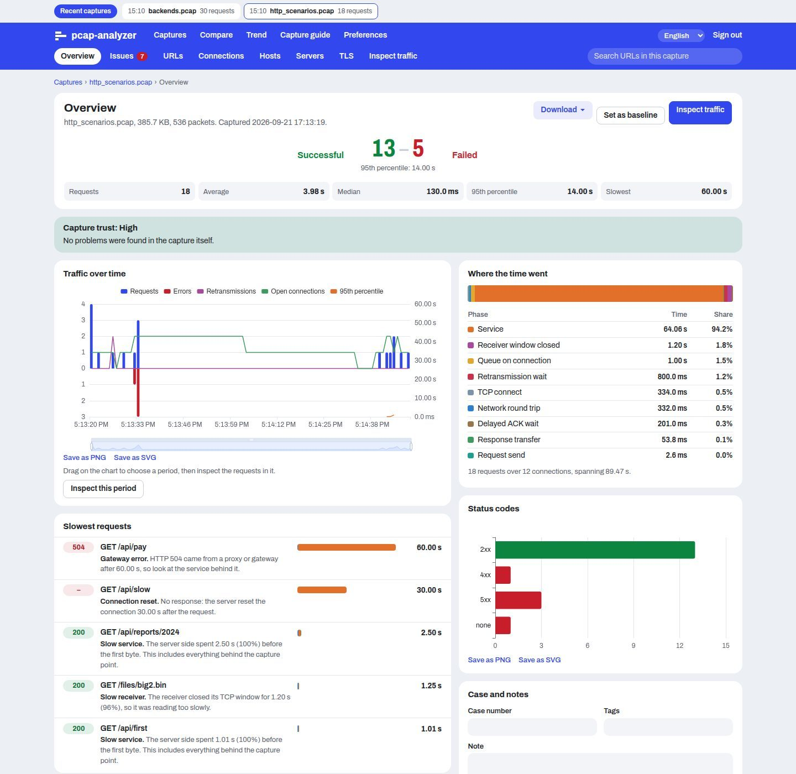
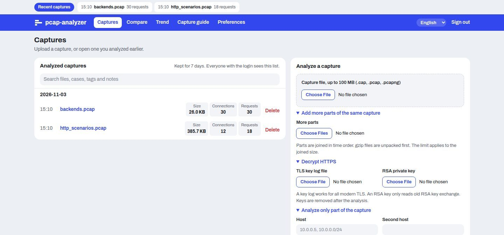
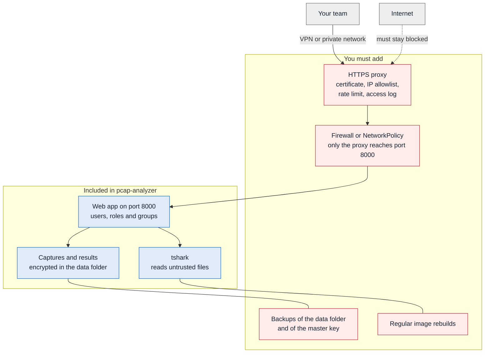

# pcap-analyzer

**Linux server edition.** Runs on a Linux server from one file, `python3 start-pcap-analyzer.py`, without internet or sudo. Other editions: [pcap-analyzer-py-k8s](https://github.com/maerdogan/pcap-analyzer-py-k8s), [pcap-analyzer-py-docker](https://github.com/maerdogan/pcap-analyzer-py-docker), and [pcap-analyzer-py](https://github.com/maerdogan/pcap-analyzer-py) with every environment.

Find out why HTTP requests are slow, from a packet capture.

Upload a PCAP and see where the time went: connection setup, network delay, service time, data transfer, or packet loss. It runs on your own server, needs no internet access, and is designed for captures taken on either side of a load balancer such as NetScaler.





> [!WARNING]
> Do not expose this application to the internet. It is built for private networks, has had no independent security review, and leaves several protections to you. Read [Security](#security) before you deploy it.

## Features

- HTTP/1.1 and HTTP/2 timing per request, grouped by URL shape such as `/users/{id}`
- TCP connection list with the slowest requests of each connection
- Inspection of one traffic pair by source, destination, port, type, URL and size
- Root cause of slow requests in plain language, with next checks and sources from a bundled knowledge base. No AI model is used
- Trust summary for each capture, traffic over time, and a per-server view that shows the odd one out behind a load balancer
- Comparison of two captures, and what a load balancer adds, measured from its two sides
- Ready capture commands for Linux servers, pods and worker nodes, including VXLAN, Geneve and `tcpdump -i any`
- Turkish, English, German and Spanish
- HTTPS decryption with a TLS key log file or RSA key
- Wireshark's views in the browser: expert information as issues, protocol hierarchy, conversations, endpoints, packet lengths, IO graph, flow graph, Stevens, throughput, round trip and window graphs, Follow TCP Stream, Export Objects, Decode As, QUIC with HTTP/3, service response times of LDAP, Kerberos, SMB2, Kafka, SMTP, DCERPC, MQTT, AMQP and FTP, SIP calls and RTP jitter and loss
- Export to CSV, Excel, JSON, PNG, SVG, HTML, HAR and PCAP
- TLS view without a key: versions, ciphers, failed handshakes, certificate end dates and chain lengths, and client certificates of mutual TLS
- Proxies and gateways: HTTP/2 flow control waits, stream resets and GOAWAY, PROXY protocol, the original client from forwarded headers, Envoy's upstream time, health checks and retries, NetScaler traces (nstrace) with both legs linked
- WebSocket and gRPC handling, gzip captures and captures in several parts
- Captures up to 1 GB, read in parts of whole connections so memory stays near 700 MiB
- Limits per URL, a baseline capture, trends across captures, case notes and an activity log
- Users with roles and groups, local or LDAP sign-in, and every file in the data folder encrypted ([Security](#security))
- REST API with tokens ([docs/api.md](docs/api.md)), and `pcap-analyzer check` for CI

See the [usage guide](docs/usage.md).

> **Status: early release.** Tested with synthetic captures on tshark 4.4 and 4.6, with real Linux traffic in a network namespace lab (`tools/lab.py`), with captures from a Kubernetes node, a pod and an NGINX Ingress pod, and with production captures from a Linux server, a `tcpdump -i any` host and both sides of a load balancer, compared with tshark and the client's own timings. Read in parts, all of these captures give the same results as in one pass, and a generated 1 GB capture was analyzed in under 3 minutes. Compose, systemd and the Linux folder are installed and walked through from start to finish by `tools/check_install.sh`. VXLAN and Geneve are tested with kernel tunnels in the lab, not yet on a multi-node cluster.

## Quick start

Copy this repository to the server, then start it from its folder. It needs no internet, no sudo, no Docker and nothing to install: Python, its packages and tshark come with it in `bundle/`.

```bash
git clone https://github.com/maerdogan/pcap-analyzer-py-linux
cd pcap-analyzer-py-linux
python3 start-pcap-analyzer.py
```

On a server without internet, download the repository as a ZIP on another machine and copy it over. The first start checks and unpacks the bundle once, writes the settings to `pcap-analyzer.env`, and starts the app in the background. Open <http://127.0.0.1:8000> and sign in as `admin` / `admin`. The app asks for a new password, then for the master key that encrypts the data folder; after that you add groups and users under **Settings → Users**.

```bash
python3 start-pcap-analyzer.py stop      # stop it
python3 start-pcap-analyzer.py restart   # read pcap-analyzer.env again
python3 start-pcap-analyzer.py status
python3 start-pcap-analyzer.py logs
python3 start-pcap-analyzer.py run       # in this terminal, until Ctrl-C
python3 start-pcap-analyzer.py cli analyze capture.pcap
```

It runs on Linux x86_64 with glibc 2.17 or newer, such as CentOS 7, RHEL 7 to 9, Ubuntu 18.04 or newer, Debian 10 or newer and SUSE 15, with any `python3` from 3.6 on. See [docs/install.md](docs/install.md) for other machines on the network, HTTPS and every setting.

## Development

```bash
pip install -e ".[dev]"
pytest
```

A tag such as `v0.8.0` runs the tests and `start-pcap-analyzer.py` on several Linux systems without network, then publishes a GitHub Release from `RELEASE_NOTES.md`. `tools/release.py` refuses a tag that does not match the version. `tools/build-bundle.sh` builds `bundle/` again on a machine with internet when Python, a package or tshark changes.

Tests use synthetic captures from `tools/gen_samples.py`. Their timings are known in advance, and they contain only private IP addresses and fake data.

## Security

Packet captures and TLS keys can contain passwords, session cookies and personal data, so anyone who reaches this application may reach that data. The red boxes below are not part of this project. You must add them yourself.



### What is not included

| Missing | Why it matters | What you must do |
|---|---|---|
| HTTPS by default | The app serves plain HTTP on port 8000, so the password, captures and TLS keys can be read on the network. | Put an HTTPS proxy in front, or start with `--cert` and `--key`. |
| Protection of port 8000 outside Kubernetes | Whoever reaches the port directly skips your proxy's HTTPS, IP allowlist and logs. | Let only the proxy reach the port, with a firewall. |
| Lockout that cannot be misused | Sign-in stops for 5 minutes after 5 failed logins from one address, or 30 from all addresses. Someone can use this to block logins for a while. Open sessions keep working. Behind a proxy, all users count as one address until you set `PCAP_ANALYZER_TRUSTED_PROXIES`. | Set that variable to your proxy's addresses, add a rate limit at the proxy, and limit who can reach the app. |
| Separate users and an audit log | Everyone shares one login that can read, download and delete every analysis. Nothing records who did it. | Limit who gets the password, change it when someone leaves, and keep access logs at the proxy. |
| Multi-factor login and SSO | One password protects all the data. | Use a long random password, and require a VPN or an authenticating proxy. |
| Encryption at rest | Captures, results and exports are plain files. | Use encrypted disks and encrypted backups. |
| Complete masking | Only known header and field names are masked. Raw captures and PCAP exports are never masked. | Treat every result, report and export as sensitive. Set `PCAP_ANALYZER_KEEP_CAPTURE=0` if you do not need PCAP export. |
| Secure wiping | Expired results are removed every hour while the server runs, and you can delete them yourself, but neither wipes the disk. | Rely on encrypted storage for safe disposal. |
| A sandbox for tshark | tshark parses untrusted files and shares the app's permissions and data. A flaw in tshark would expose everything the app can read. | Run it in a non-root container, update tshark often, and analyze only captures from sources you trust. |
| Resource limits | Without root, `start-pcap-analyzer.py` cannot limit CPU and memory, so a large analysis can take the whole server. | Keep `PCAP_ANALYZER_MAX_JOBS` low, or run it on a server with room to spare. |
| Signed releases | The bundle is checked against `bundle/runtime.sha256`, but it is not signed, and bundled JavaScript does not update itself. | Build the bundle yourself with `tools/build-bundle.sh` and keep it up to date. |

### Users, roles and groups

The setup admin (`PCAP_ANALYZER_ADMIN_USER`, `admin` by default) signs in first with `admin` / `admin` and must choose a new password. Under **Settings → Users** an admin adds groups, with a description, and users: user name, full name, employee ID, group, role, and whether they sign in with a local password or through LDAP. The setup admin is listed there but cannot be changed or deleted. A group that still has users cannot be deleted.

| Role | Can |
|---|---|
| viewer | open captures and export them |
| analyst | also upload, delete the captures they uploaded, write notes, set a baseline and save filters |
| admin | also manage users, preferences, API tokens, the activity log and encryption, and see every group |

Anything a role may not do gets `403`. Every capture records who uploaded it and in which group. A user sees only the captures of their own group, on every page, export, comparison, trend, baseline and REST call, and a capture or job of another group answers `404`. Admins see all groups. Captures analyzed before groups existed, and uploads by the setup admin, belong to no group, so only admins see them. Only the uploader or an admin may delete a capture.

Local users must change their password at the first sign-in and after an admin resets it. Every password, the setup admin's too, needs at least 12 characters and may not be `admin` or the user name. A local user's password is kept as a scrypt hash inside the encrypted users file.

For LDAP, an admin sets the server (`ldap://` or `ldaps://`), a service account DN and password, the base DN and a user filter with `{0}` for the user name, such as `(sAMAccountName={0})`, and can test the connection. An LDAP user is found with the service account, with the name escaped as RFC 4515 says, and then signs in by binding as that user. Empty passwords are refused. The group and role still come from the app. `ldaps://` checks the server certificate against the system's trusted certificates, or against `PCAP_ANALYZER_LDAP_CA_FILE`.

### Encryption at rest

Everything the app keeps in its data folder is encrypted: captures, analysis databases and results, cached statistics, exported objects, notes, users and groups, LDAP settings, preferences, baselines, saved filters, API tokens and the activity log.

- Each file has its own random AES-256-GCM key and is encrypted in 1 MiB segments. A segment's nonce is a random prefix of the file and the segment number, and the associated data marks the last segment, so a changed, reordered or cut file is found.
- The file key is wrapped with an RSA-2048 data key pair (OAEP, SHA-256). Writing needs only its public half.
- The data private key is sealed with a key derived from the master key (PBKDF2-HMAC-SHA256, 310,000 rounds). The master key has exactly 16 characters, at least one of them neither a letter nor a digit.
- The master key is wrapped with a second RSA-2048 key pair, whose private key is sealed with the setup admin's password (PBKDF2-HMAC-SHA256, 310,000 rounds). A new admin password wraps only the admin key again, and a new master key seals only the data private key again, so no file is rewritten.
- Each analysis database is encrypted with DuckDB's own AES-256-GCM encryption and a random key of its own, kept next to it as an encrypted file, when DuckDB's `httpfs` extension is already installed on the host, since DuckDB writes encrypted databases securely only with it; nothing is downloaded. Otherwise, as in the container image, the Linux bundle and `linux-glibc2.17-server`, the vault encrypts the whole database file and a page reads it from a private plain copy, in `/dev/shm` when it has room, else in the temporary folder, that is removed right after.
- tshark reads an encrypted capture through a pipe, decrypted as it is read.

The first setup: after the new password, the setup admin sets the master key on **Settings → Encryption**, entering the password again. Every file already in the data folder is then encrypted, and lines of the activity log written before are encrypted too; until then other users see a waiting page. After every restart nothing can be read until the setup admin signs in, and other users get a waiting page (`503`). The setup admin can show the master key, change it, and read how the data is encrypted on the same page. Keep a copy of the master key and of the admin password somewhere safe: without both, the data folder cannot be opened, and a copy of it opens nowhere else.

A file in the data folder that was changed, cut, left unencrypted, or encrypted by another install raises a notice for admins on every page and is listed on the Encryption page until marked as seen. Files are checked whenever they are read, and the whole folder every hour.

The activity log is kept in `.idx0`, whose name says nothing about it, and every line is encrypted on its own, so lines are added while the data is locked too. It records who did what, from which address and when.

### Retention

An analysis nobody opened for `PCAP_ANALYZER_TTL_DAYS` days (7 by default) is deleted at start and every hour, whether or not anyone uses the app. Opening any page of it counts, at most once an hour; one never opened counts from its upload. This works from file times, so it runs while the data is locked too.

### Before you upload

- Make sure you may capture and analyze this traffic. Captures can hold personal data, so your privacy rules apply, such as KVKK or GDPR.
- Treat a TLS key log like a password, because it decrypts every session it covers. Delete it after use. The app removes its copy after analysis. If a process is killed, the hourly cleanup removes the copy within 7 hours.
- gzip captures are unpacked up to the size limit. zstd and lz4 files are refused, because their real size cannot be checked. ZIP and other archives are refused with a note to extract them.
- Never commit captures or keys, and never attach them to public issues.

## License

[MIT](LICENSE). See [THIRD_PARTY.md](THIRD_PARTY.md) for bundled components.

## Roadmap

[ROADMAP.md](ROADMAP.md) lists every roadmap item and its state. The [project board](https://github.com/users/maerdogan/projects/6) is shared by all editions.
