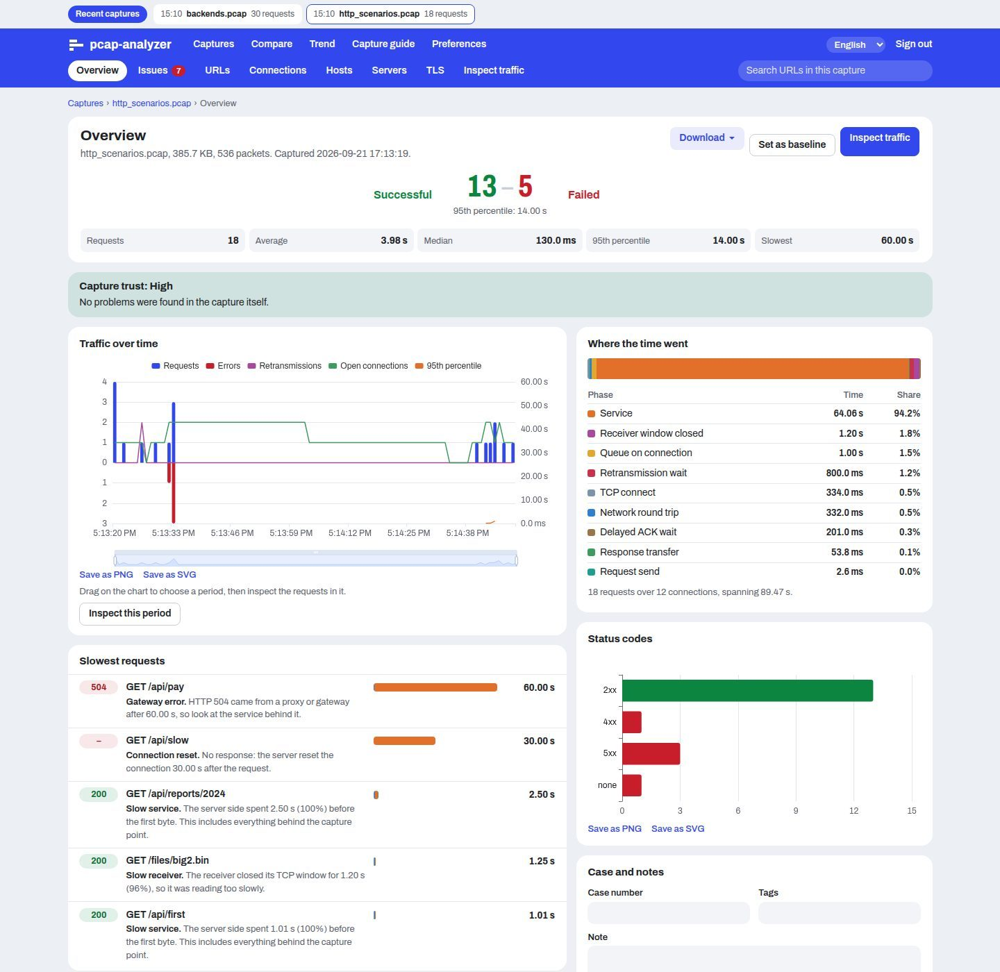
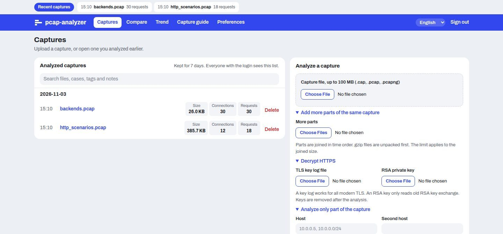

# Using pcap-analyzer

This walks through one slow-request case with the sample `http_scenarios.pcap`, which `tools/gen_samples.py` creates.

## 1. Take a capture

Open **Capture guide**, fill in the server address and port, and copy the command for where you can run it: a Linux server, a pod or a worker node. To see what a load balancer adds, capture on both sides at the same time.

## 2. Upload it

On **Captures**, choose the file. gzip files and several parts of one capture work too, up to 1000 MB after unpacking. A ZIP or other archive must be extracted first.

To read HTTPS, add a TLS key log under **Decrypt HTTPS**. Pick several to decrypt both sides of a proxy, such as the client and server legs of a NetScaler; they are joined into one, without duplicate lines. Key logs can be up to 512 MB together, such as one from NetScaler with the keys of every session it served. A key log over 8 MB is cut to the sessions in the capture before tshark reads it. An RSA key must be a PEM file. Convert a `.pfx` with `openssl pkcs12 -in FILE.pfx -nocerts -nodes -out key.pem`.

## 3. Read the overview

The scoreboard shows successful and failed requests. In the sample that is 13 and 5. **Where the time went** shows that service took 94% of the time, so the wait is behind the capture point and not on the network.

Check **Capture trust** first. A low value means packets are missing and the numbers may be wrong.

## 4. Open the slowest request

`GET /api/pay` took 60.00 s and ended with 504. The page explains what that means, what this capture shows and what to check next. Exactly 60 seconds points to a timeout such as NGINX's `proxy_read_timeout`.

## 5. Narrow it down

A port that carries another protocol than its usual one, such as HTTP on 9000, can be read with **Decode As** under the filters on the upload page, as `tcp.port==9000,http`.

- **Issues** lists problems by weight. Open one to see its requests.
- **URLs** groups similar addresses.
- **Connections** lists every TCP connection. A connection page shows its requests on a time axis, every packet in order, and Follow TCP stream as text, hex or HTTP.
- **Servers** marks a backend that stands out from its peers.
- **TLS** shows versions, ciphers and failed handshakes, also without a key.
- **Statistics** reads the packets again, as Wireshark's Statistics menu does: protocol hierarchy, packet lengths, UDP and Ethernet conversations, MAC and IP endpoints, an IO graph and the flow graph for a display filter picked from a list, HTTP load distribution and request sequences, QUIC connections and Export Objects. A large capture takes a few minutes the first time, and the result is kept.
- A connection page also has Stevens, throughput, round trip and window graphs, its flow graph and **Follow TCP stream**. Follow Stream masks known secret headers, but files from Export Objects are raw and not masked.
- **Statistics** also times requests of other protocols: LDAP, Kerberos, SMB2, Kafka, SMTP, DCERPC, MQTT, AMQP and FTP. It lists SIP calls, and RTP streams with loss, reordering and jitter.
- **Issues** also lists what Wireshark's expert information shows on single packets: malformed packets, ICMP destination unreachable, DNS errors, invalid TCP flags, reused ports, ECN congestion marks, SACK blocks and packets the capture itself dropped.
- **Inspect traffic** filters by address, port, URL and size.

## 6. Compare and follow

- **Compare** shows two captures side by side, before and after a change, or both sides of a load balancer. A `traceparent` or `X-Request-ID` header gives exact matches.
- **Set as baseline** on a healthy capture makes later captures of your group list what changed. Each group has its own baseline.
- **Trend** follows one URL across the captures of your group.
- **Preferences** holds the slow request limit, URL targets and API tokens. Admins only.

Each user is in one group and sees only the captures of that group; admins see all. Viewers open and export, analysts also upload, delete their own captures, write notes and save filters, and admins also manage **Users**, **Encryption**, **Preferences** and the **Activity log** under **Settings**. See [Security](../README.md#security).

## 7. Share the result

**Download** gives the HTML report, CSV, Excel, JSON and HAR. Secrets in headers and URLs are masked in all of them. Add a case number and notes on the overview, and they go into the report.

## What each cause means

| Cause | Meaning |
|---|---|
| Slow service | The server took long before its first byte. |
| Network delay | Round trip time took the largest share. |
| Packet loss | Retransmissions cost the time. |
| Slow client | The receiver closed its TCP window. |
| Slow transfer | The body took long to arrive. |
| Slow upload | The request took long to send. |
| Queueing | The request waited for an earlier response on the same connection. |
| Delayed ACK | A sender waited for a late ACK. |
| Slow connect | The TCP handshake took long. |
| Slow TLS | The TLS handshake took long. |
| Gateway error | A proxy returned 502, 503 or 504. |
| No response | No answer arrived before the capture ended. |
| Connection reset | The connection ended with RST before an answer. |
| Incomplete response | Fewer bytes arrived than Content-Length said. |
| WebSocket connection | The connection switched to WebSocket. Only the upgrade is measured. |
